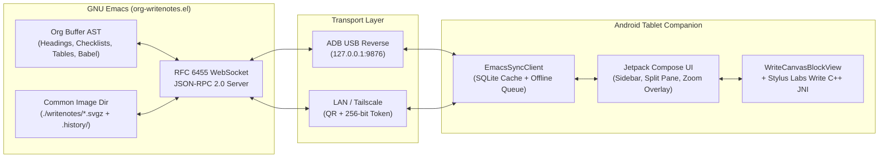

# Org-WriteNotes

**Org-WriteNotes** is a hybrid Android tablet companion app and zero-dependency GNU Emacs package (`org-writenotes.el`) for editing Org-mode documents with embedded, dynamically expanding handwritten ink canvases powered by the **[Stylus Labs Write](https://github.com/styluslabs/Write)** C++ engine.

Write structured notes, manage tasks, execute Babel code blocks, and sketch high-precision vector diagrams with an S-Pen or USI stylus—all stored natively in your `.org` files and standard `.svgz` vector files with zero cloud lock-in.

---

## Key Features

### 1. Native Stylus Handwriting & C++ Vector Ink Engine
- **Stylus Labs Write C++ Core via JNI:** Ultra-low-latency pressure- and tilt-sensitive vector strokes serialized directly to standard block-gzipped `.svgz` files.
- **Rich Stylus Toolset:**
  - **Pen Tips & Presets:** Ballpoint, Fountain, Brush, Chisel (configurable angle), Highlighter, and 6 customizable one-tap **Favorite Pen Slots**.
  - **Ruled & Standard Eraser:** Erase whole strokes or snap-erase along ruling lines.
  - **Lasso Selection & Restyling:** Freeform lasso with move, scale, rotate, duplicate, cross-sketch copy/paste, and live stroke recoloring/rewidening.
  - **Hold-to-Snap Geometric Shapes:** Pause 400 ms at the end of a stroke to snap freehand lines, arrows, axis-aligned rectangles, or circles/ellipses (with optional grid snapping).
  - **Laser Pointer Mode:** Stream a live glowing pointer trail to your Emacs buffer during presentations or screen sharing without modifying the saved `.svgz`.
- **Hardware Stylus & Touch Ergonomics:**
  - **Palm Rejection & Stylus-Only Mode:** Single-finger scrolling passes cleanly through inline canvases; holding the S-Pen barrel button temporarily engages Lasso Select.
  - **Procreate-Style Multi-Touch Gestures:** Two-finger tap to **Undo**, three-finger tap to **Redo**, and pinch-to-zoom with a live **Viewport Minimap** navigator.
  - **Stroke Tuning:** Configurable stroke smoothing, pressure gamma curve, and tilt sensitivity.
- **Dynamic Canvas & Paper Templates:**
  - Automatic vertical canvas expansion as you write near the bottom edge, plus one-tap **Trim Bottom Whitespace**.
  - Built-in paper rulings: **Ruled, College, Narrow, Quad Grid, Dotted Grid, Engineering 5×5, Isometric 30°/60°, Music Staff, Cornell Notes, and Weekly Planner**.
  - **Layer Controls:** Lock/unlock background template layers, adjust template image opacity, and toggle highlighter layer visibility.
  - **Tiled Large-Canvas Rendering:** Viewport-culled tiled rendering (`nativeRenderTileToBitmap`) for massive diagrams (>16 MP).

### 2. Smart Ink: Offline OCR, Audio Sync & Image Markup
- **100% On-Device Handwriting OCR (Google ML Kit):**
  - **Lasso → Convert to Text:** Convert selected handwritten notes into native Org paragraphs or checklist items on the fly.
  - **Smart Math & Checklist Detection:** Automatically converts drawn `[ ]` boxes into interactive Org checklists and handwritten math expressions into LaTeX (`$...$`).
  - **Searchable `:WRITENOTES_OCR:` Drawers:** Optionally index recognized handwriting inside folded Org drawers beneath each sketch link so `isearch`, `ripgrep`, `consult-line`, and `org-ql` search inside your diagrams natively.
- **Audio-Synced Sketches:** Record voice notes while sketching; each pen stroke is timestamp-indexed to the audio track so you can jump backward/forward stroke-by-stroke during playback.
- **Image & Diagram Annotation:**
  - Run `M-x org-writenotes-annotate-image-at-point` in Emacs on any `[[file:diagram.png]]` link to wrap it as a background template and open it on the tablet for stylus markup.
  - Share images from any Android app (`ACTION_SEND`) or paste from the clipboard directly onto your active canvas.
  - Export sketches as **PNG** or **SVG**, or import external Write `.svgz` files.

### 3. Full Org-Mode Productivity on the Tablet
- **5-Tab Sidebar Navigator:**
  - **History:** Recently pushed headings from Emacs.
  - **Outline:** Full hierarchical heading tree of the active `.org` buffer with collapse/expand and sketch count badges (`🎨`).
  - **Agenda:** Scheduled/deadline items and active `TODO`/`NEXT` tasks across `org-agenda-files`.
  - **Search:** Instant full-text, title, and tag search across your Org directory and `org-roam`.
  - **Gallery:** Visual thumbnail grid of all `.svgz` sketches with one-tap jump to the parent heading.
- **Rich Interactive Org AST Blocks:**
  - **Header Card & Metadata:** Cycle `TODO`/`NEXT`/`DONE` states, set priorities (`[#A]`–`[#C]`), edit `:tags:`, pick `SCHEDULED` and `DEADLINE` dates via Material 3 DatePickers, and edit `:PROPERTIES:` drawers.
  - **Live `org-clock` Timer:** Clock in/out directly from the tablet header with a live elapsed timer synced to Emacs.
  - **Power Checklists:** Toggle `[X]` / `[ ]` / `[-]` (partial), inline-edit item text, indent/outdent hierarchy, reorder items, or add new items.
  - **Org Babel Source Blocks:** View syntax-styled `#+BEGIN_SRC` blocks and tap **▶ Run** to execute via `org-babel-execute-src-block` in Emacs and view live `#+RESULTS:`.
  - **Interactive Org Tables & Subheadings:** Edit table cells inline and drill down into child subheadings with a top **Breadcrumb Trail**.
  - **Split-Pane View:** View and edit a sketch side-by-side with the node's Org text or a second reference sketch.
  - **Spaced Repetition (`org-drill`):** Flag headings as flashcards (`:drill:`) directly from the tablet or Emacs (`C-c w f`).

### 4. Resilient Bidirectional Sync & Offline-First Architecture
- **Zero-Dependency Emacs Server:** Built-in RFC 6455 WebSocket + JSON-RPC 2.0 server in pure Elisp—no external Python/Node bridges required.
- **Flexible Transport & Pairing:**
  - **USB (Zero-Config):** One-command `adb reverse tcp:9876 tcp:9876` tunnel (`M-x org-writenotes-connect-adb`).
  - **Wireless LAN / Tailscale:** Token-authenticated QR code pairing (`M-x org-writenotes-pair-qr` or `M-x org-writenotes-pair-tailscale`) with brute-force rate limiting.
- **Offline SQLite Cache & Mutation Coalescing:**
  - Browse cached nodes, edit text/checklists, and create or modify sketches completely offline.
  - Pending mutations are persisted in SQLite (`OfflineStore`) with automatic coalescing and replayed upon reconnection.
  - Crash-recovery snapshots and automatic flush on `ON_PAUSE` / `onTrimMemory`.
- **Data Safety & Conflict Protection:**
  - Atomic `.svgz` disk writes (`temp + rename`) and automatic rolling snapshot history (`writenotes/.history/`) with one-command revert (`M-x org-writenotes-revert-sketch-at-point`).
  - Optimistic concurrency via SHA-1 `etag` / `baseEtag` verification—conflicting edits are safely preserved as `*.conflict-<timestamp>.svgz`.
- **Dark Mode & Theme Synchronization:**
  - Emacs broadcasts its active theme palette (`isDark`, background, foreground, accent) to the tablet.
  - Adaptive inline `.svgz` rendering in Emacs (`org-writenotes-inline-theme`) automatically adjusts paper and ink contrast in dark mode without altering the saved `.svgz` file on disk.

---

## Architecture Overview



---

## Repository Structure

| Path | Description |
| :--- | :--- |
| [`emacs/org-writenotes.el`](emacs/org-writenotes.el) | Core Emacs package: RFC 6455 WebSocket server, JSON-RPC 2.0 dispatcher, Org AST parser/mutator, adaptive `.svgz` inline image renderer, and `org-writenotes-follow-mode`. |
| [`emacs/org-writenotes-extras.el`](emacs/org-writenotes-extras.el) | Extended capabilities: atomic writes, `.history/` version snapshots, `etag` conflict copies, Tailscale pairing, `org-roam` sketch backlinks, link repair, `ox-html` inline SVG export, and `C-c w` transient menu. |
| [`docs/protocol-spec.md`](docs/protocol-spec.md) | JSON-RPC 2.0 over WebSocket wire protocol specification (`session.hello`, `node.*`, `ink.*`, `emacs.*`, `presence.*`). |
| [`android/app/src/main/cpp/write_bridge_jni.cpp`](android/app/src/main/cpp/write_bridge_jni.cpp) | C++ JNI bridge (`NativeCanvasSession`) wrapping Stylus Labs Write's `Document`, `Page`, `StrokeBuilder`, shape recognizer, paper templates, tiled renderer, and `.svgz` serializer. |
| [`android/app/src/main/java/com/orgwritenotes/ink/`](android/app/src/main/java/com/orgwritenotes/ink/) | `WriteCanvasBlockView` (stylus input, palm rejection, gestures), `HandwritingOcrEngine` (ML Kit), `OcrSmartInsert`, `AudioSketch`, `SvgLayers`, and `StrokeTuning`. |
| [`android/app/src/main/java/com/orgwritenotes/sync/`](android/app/src/main/java/com/orgwritenotes/sync/) | `EmacsSyncClient` (WebSocket JSON-RPC client, auto-reconnect, mutation coalescing), `OfflineStore` (SQLite persistence), and `AppLogger`. |
| [`android/app/src/main/java/com/orgwritenotes/ui/`](android/app/src/main/java/com/orgwritenotes/ui/) | Jetpack Compose tablet UI: `OrgWriteNotesTabletScreen`, `WriteZoomedEditorOverlay`, `WriteSplitPane`, and `WriteExtrasBar`. |

---

## Quick Start

### 1. Emacs Setup

Requirements: **GNU Emacs 28.1+** (built with `librsvg` and `zlib` support) and **Org 9.5+**.

```elisp
(add-to-list 'load-path "/path/to/org-writenotes/emacs")
(require 'org-writenotes)

;; Store all .svgz sketches in a single common folder (relative to the .org file or global)
(setq org-writenotes-image-dir "./writenotes")

;; Adaptive inline .svgz theme ('auto adapts to dark/light Emacs themes, 'paper, or 'transparent)
(setq org-writenotes-inline-theme 'auto)

;; Start the WebSocket server and set up ADB USB reverse port forwarding (localhost:9876)
(org-writenotes-connect-adb)

;; Automatically push the active Org heading to the tablet as you move point
(org-writenotes-follow-mode 1)

;; Enable the C-c w keybinding prefix in Org buffers
(add-hook 'org-mode-hook #'org-writenotes-mode)
```

### 2. Building & Installing the Android App

Connect your Android tablet via USB (with USB Debugging enabled) and run the helper script:

```bash
./android/build_and_install.sh
```

Or build manually with Gradle:

```bash
cd android
./gradlew assembleDebug
adb install -r app/build/outputs/apk/debug/app-debug.apk
adb reverse tcp:9876 tcp:9876
```

---

## Emacs Commands & Keybindings

When `org-writenotes-mode` is active in an Org buffer, use the `C-c w` prefix (or invoke `M-x org-writenotes-menu` for the interactive Transient popup):

| Key / Command | Description |
| :--- | :--- |
| `M-x org-writenotes-connect-adb` | Start the WebSocket server and run `adb reverse tcp:9876 tcp:9876` for USB pairing. |
| `C-c w q` / `M-x org-writenotes-pair-qr` | Start the server on LAN and display a QR code + session token for wireless pairing. |
| `C-c w t` / `M-x org-writenotes-pair-tailscale` | Bind to your Tailscale IPv4 (`100.x.y.z`) and generate a Tailscale pairing QR code. |
| `C-c w p` / `M-x org-writenotes-push-node` | Push the Org subtree at point to the connected tablet. |
| `M-x org-writenotes-insert-sketch` | Create a new `.svgz` canvas, insert `[[file:./writenotes/...svgz]]` at point, and open it on the tablet. |
| `M-x org-writenotes-open-sketch-at-point` | Open the `.svgz` link at point directly in the tablet's full-screen zoomed editor (also bound to `C-c C-o` on `.svgz` links). |
| `M-x org-writenotes-annotate-image-at-point` | Wrap a PNG/JPEG/WebP image link at point as the background template of a new `.svgz` sketch and open on the tablet. |
| `M-x org-writenotes-delete-sketch-at-point` | Delete the `.svgz` link at point and remove its file from disk. |
| `C-c w r` / `M-x org-writenotes-revert-sketch-at-point` | Restore a previous version of the `.svgz` sketch at point from `.history/`. |
| `C-c w b` / `M-x org-writenotes-show-sketch-backlinks` | List all Org headings (including `org-roam` files) referencing the sketch at point. |
| `C-c w l` / `M-x org-writenotes-repair-links` | Automatically repair broken `.svgz` file links in the current buffer. |
| `C-c w f` / `M-x org-writenotes-flag-as-flashcard` | Flag the current Org heading as an `org-drill` spaced-repetition card (`:drill:`). |
| `M-x org-writenotes-gallery` | Open an interactive gallery buffer of all `.svgz` sketches with thumbnails and heading links. |
| `M-x org-writenotes-clean-orphans` | Scan `.org` files for unreferenced `.svgz` files and move orphans to `.trash/`. |
| `C-c w w` / `M-x org-writenotes-menu` | Open the Transient command menu. |

---

## Customization Variables

| Variable | Default | Description |
| :--- | :--- | :--- |
| `org-writenotes-image-dir` | `"./writenotes"` | Directory (relative to `.org` file or absolute) where `.svgz` files are stored. |
| `org-writenotes-port` | `9876` | TCP port for the WebSocket JSON-RPC server. |
| `org-writenotes-inline-theme` | `'auto` | Inline SVG rendering mode in Emacs (`'auto`, `'paper`, or `'transparent`). |
| `org-writenotes-inline-max-width` | `760` | Maximum pixel width for inline `.svgz` previews in Emacs (`nil` for native width). |
| `org-writenotes-sketch-history-depth` | `20` | Number of historical snapshots retained per sketch inside `.history/`. |
| `org-writenotes-auto-sync-ocr-drawer` | `nil` | When non-nil, automatically insert/update folded `:WRITENOTES_OCR:` drawers on ink commit. |
| `org-writenotes-live-stroke-preview` | `nil` | When non-nil, splice incoming `ink.delta` strokes into Emacs inline previews in real time. |
| `org-writenotes-html-inline-svgz` | `t` | Inline `.svgz` links directly as `<svg>` elements during `ox-html` export. |

---

## Testing

Run the Emacs ERT test suites in batch mode:

```bash
emacs -Q --batch -L emacs \
  -l emacs/org-writenotes-test.el \
  -l emacs/org-writenotes-extras-test.el \
  -f ert-run-tests-batch-and-exit
```

Run the Android JVM unit and protocol golden tests:

```bash
cd android
./gradlew testDebugUnitTest
```
