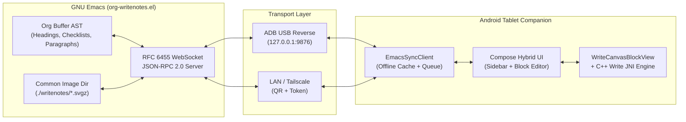

# Org-WriteNotes: Comprehensive Improvement Roadmap & Feature Brainstorm

This document catalogs architectural improvements, bug fixes, UX enhancements, and new capabilities for **Org-WriteNotes** across its three layers:
1. **Emacs Server & Org AST Layer** ([emacs/org-writenotes.el](file:///home/saisan/.vim/emacs_plugin/org-writenotes/emacs/org-writenotes.el))
2. **Wire Protocol & Sync Client** ([docs/protocol-spec.md](file:///home/saisan/.vim/emacs_plugin/org-writenotes/docs/protocol-spec.md), [EmacsSyncClient.kt](file:///home/saisan/.vim/emacs_plugin/org-writenotes/android/app/src/main/java/com/orgwritenotes/sync/EmacsSyncClient.kt))
3. **Android Tablet UI & Stylus Labs Write C++ Engine** ([OrgWriteNotesTabletScreen.kt](file:///home/saisan/.vim/emacs_plugin/org-writenotes/android/app/src/main/java/com/orgwritenotes/ui/OrgWriteNotesTabletScreen.kt), [WriteZoomedEditorOverlay.kt](file:///home/saisan/.vim/emacs_plugin/org-writenotes/android/app/src/main/java/com/orgwritenotes/ui/WriteZoomedEditorOverlay.kt), [WriteCanvasBlockView.kt](file:///home/saisan/.vim/emacs_plugin/org-writenotes/android/app/src/main/java/com/orgwritenotes/ink/WriteCanvasBlockView.kt), [write_bridge_jni.cpp](file:///home/saisan/.vim/emacs_plugin/org-writenotes/android/app/src/main/cpp/write_bridge_jni.cpp))

---

## Architecture Overview & Current Gaps



---

## Tier 1: Sync Reliability, Correctness & Protocol Completeness

### 1.1 Read Actual `.svgz` Metadata in Emacs (`width`, `height`, `xruling`, `yruling`)
- **Current Problem:** In [`org-writenotes--extract-blocks`](file:///home/saisan/.vim/emacs_plugin/org-writenotes/emacs/org-writenotes.el#L459-L470), every `ink_canvas` block sent to the tablet hardcodes `:width org-writenotes-default-canvas-width` (1200), `:height org-writenotes-default-canvas-height` (600), `:xRuling 40`, and `:yRuling 40`, even after the user has expanded or customized the page on the tablet (though the C++ engine reads the real SVG dimensions once `nativeLoadSvgz` runs, the initial Compose layout height and `WritePageSetupState` start with 1200x600).
- **Proposed Fix:** Parse the `<svg width="..." height="...">` and `<g class="write-content..." xruling="..." yruling="..." papercolor="..." rulecolor="..." rulingstyle="...">` attributes from the decompressed `svg-xml` in [`org-writenotes--extract-blocks`](file:///home/saisan/.vim/emacs_plugin/org-writenotes/emacs/org-writenotes.el#L456-L470) so the snapshot immediately reflects the true dimensions and ruling setup.

### 1.2 Live Bidirectional Sync (`emacs.nodeModified`) & Optimistic Concurrency (`etag`)
- **Current Problem:**
  - [`org-writenotes--parse-subtree-at-point`](file:///home/saisan/.vim/emacs_plugin/org-writenotes/emacs/org-writenotes.el#L359-L361) computes `:etag` (`tick-<modified>-sha1-<hash>`), and [protocol-spec.md](file:///home/saisan/.vim/emacs_plugin/org-writenotes/docs/protocol-spec.md#L158-L159) specifies `emacs.nodeModified`, but typing in the `.org` buffer inside Emacs does not push updates to the tablet unless the user manually runs `M-x org-writenotes-push-node`.
  - Line-based mutations (`startLine`, `endLine`, `line` in [`org-writenotes--handle-toggle-checkbox`](file:///home/saisan/.vim/emacs_plugin/org-writenotes/emacs/org-writenotes.el#L543-L560) and [`org-writenotes--handle-update-paragraph`](file:///home/saisan/.vim/emacs_plugin/org-writenotes/emacs/org-writenotes.el#L621-L659)) can target the wrong line if lines were inserted above the active node in Emacs.
- **Proposed Fix:**
  - Add an `after-save-hook` and/or debounced `after-change-functions` watcher in [org-writenotes.el](file:///home/saisan/.vim/emacs_plugin/org-writenotes/emacs/org-writenotes.el) that checks if the `:etag` of `org-writenotes--active-node-id` changed, and broadcasts `emacs.nodeModified`.
  - Auto-assign a persistent `:ID:` property (`org-id-get-create`) when pushing a node so `nodeId` is always `file:<path>::id:<uuid>` rather than volatile `line:<N>`.
  - Pass `baseEtag` on tablet text/checklist mutations; if the buffer changed in Emacs, locate targets relative to the heading's current start marker (`(cdr loc)`) rather than absolute buffer line numbers.

### 1.3 Offline Mutation Queue Coalescing & Conflict Recovery
- **Current Problem:** [`EmacsSyncClient.kt`](file:///home/saisan/.vim/emacs_plugin/org-writenotes/android/app/src/main/java/com/orgwritenotes/sync/EmacsSyncClient.kt#L52) appends every offline RPC call to `offlineMutationQueue`. If a user edits a sketch 20 times while offline, 20 full `ink.commit` payloads (each containing base64 `.svgz` bytes) are queued to `offline_queue.json` and replayed sequentially.
- **Proposed Fix:**
  - Coalesce `ink.commit` mutations in `offlineMutationQueue` by `(nodeId, fileName)` so only the latest `.svgz` payload per sketch is retained.
  - Coalesce `node.updateHeader` and `node.setProperty` by `(nodeId, key)`.
  - Support **Offline Sketch Creation**: When offline, allow `insertInkBlock` to generate a local filename (`<slug>-<timestamp>.svgz`), create the blank canvas immediately on the tablet, and queue both `node.insertInkBlock` and subsequent `ink.commit` calls for replay when reconnected.

### 1.4 Enforce Session Token Auth & Automatic Reconnection
- **Current Problem:**
  - [`org-writenotes-pair-qr`](file:///home/saisan/.vim/emacs_plugin/org-writenotes/emacs/org-writenotes.el#L1177-L1204) generates `org-writenotes--session-token`, and [`EmacsSyncClient`](file:///home/saisan/.vim/emacs_plugin/org-writenotes/android/app/src/main/java/com/orgwritenotes/sync/EmacsSyncClient.kt#L124) sends it in `session.hello`, but [`org-writenotes--dispatch-rpc`](file:///home/saisan/.vim/emacs_plugin/org-writenotes/emacs/org-writenotes.el#L949-L954) never verifies the token.
  - When the USB cable is bumped or tablet wakes from sleep, the user must manually tap the connection pill to reconnect.
- **Proposed Fix:**
  - Verify `:token` in `session.hello` whenever the server is bound to `0.0.0.0` (non-loopback), rejecting unauthenticated RPC calls.
  - Add a background reconnection loop with exponential backoff (`1s -> 2s -> 5s -> 10s`) in [`EmacsSyncClient.kt`](file:///home/saisan/.vim/emacs_plugin/org-writenotes/android/app/src/main/java/com/orgwritenotes/sync/EmacsSyncClient.kt) when `ConnectionState` transitions to `OFFLINE_CACHED` or `ERROR`, plus automatic reconnect on Android `Lifecycle.Event.ON_RESUME`.

### 1.5 Real-Time `ink.delta` Streaming or Removal of Redundant Traffic
- **Current Problem:** Every pen stroke sends an `ink.delta` RPC message with `pathXml` ([`EmacsSyncClient.kt`](file:///home/saisan/.vim/emacs_plugin/org-writenotes/android/app/src/main/java/com/orgwritenotes/sync/EmacsSyncClient.kt#L407-L415)), and simultaneously calls `exportSvgzBase64Provider()` on the UI thread on *every single stroke* (line 388), while Emacs ignores `ink.delta` (`(:ok t)`).
- **Proposed Fix:**
  - **Performance win:** Do *not* run full `nativeExportSvgz` + Base64 encoding on every pen-up on the main thread! Instead, only export `.svgz` inside the 3.0s debounce coroutine (or when switching/closing nodes).
  - **Optional Live Emacs Preview:** If `org-writenotes-live-stroke-preview` is enabled in Emacs, splice `pathXml` into the cached SVG XML in memory and update the Emacs image overlay immediately without disk I/O until `ink.commit` arrives.

---

## Tier 2: Richer Org-Mode AST & Tablet Productivity

### 2.1 Full Org Agenda, Outline Tree & `org-roam` Browser in Sidebar
- **Current Problem:** [`org-writenotes--collect-node-summaries`](file:///home/saisan/.vim/emacs_plugin/org-writenotes/emacs/org-writenotes.el#L527-L537) only returns `org-writenotes--pushed-history`. You cannot browse an `.org` file or your Agenda from the tablet unless you already pushed each heading from Emacs.
- **Proposed Enhancement:** Add filter tabs to the Left Sidebar in [`OrgWriteNotesTabletScreen.kt`](file:///home/saisan/.vim/emacs_plugin/org-writenotes/android/app/src/main/java/com/orgwritenotes/ui/OrgWriteNotesTabletScreen.kt#L354-L428):
  1. **History:** Recently pushed nodes (current behavior).
  2. **Buffer Tree:** Full hierarchical outline of the active `.org` buffer in Emacs with indent levels, collapsible parent headings, and sketch count badges (`🎨 2`).
  3. **Agenda / TODOs:** Nodes across `org-agenda-files` with `SCHEDULED`/`DEADLINE` for today/this week or active `TODO`/`NEXT` keywords.
  4. **Search / `org-roam`:** Full-text / heading title / tag search across `org-directory` or `org-roam-directory`.

### 2.2 Create New Headings & Trigger `org-capture` from Tablet (`node.create`)
- **Idea:** Add a `+ New Heading / Capture` button in the tablet sidebar and editor header:
  - **Insert Sibling / Child Heading:** Create a new `* TODO ...` child or sibling node in the current `.org` file and immediately open a fresh `.svgz` sketch inside it.
  - **Quick Capture:** Send a new capture note (with an optional sketch + title + tags) into a configured `org-writenotes-capture-file` / heading in Emacs.

### 2.3 Rich Org Block Types: Subheadings, Code Blocks, Tables, & Quotes
- **Current Problem:** [`org-writenotes--extract-blocks`](file:///home/saisan/.vim/emacs_plugin/org-writenotes/emacs/org-writenotes.el#L443-L504) stops parsing at the first child heading (`(not (org-at-heading-p))`) and lumps `#+BEGIN_SRC`, tables, drawers, and bullet lists into raw `paragraph` blocks.
- **Proposed Enhancement:**
  - **Child Subheadings Bar:** At the bottom of a node (or inline), list direct child headings (`** Subtask 1 [1/3]`, `** Subtask 2`) as tappable cards so you can drill down into subtrees and navigate back up via a **Breadcrumb Trail** (`Projects > Org-WriteNotes > Sync Engine`) at the top of the editor pane.
  - **Source Code Blocks (`code_block`):** Render `#+BEGIN_SRC <lang> ... #+END_SRC` with a monospace syntax-highlighted card, copy button, and a **▶ Run (`org-babel-execute-src-block`)** button that executes the block in Emacs and displays the `#+RESULTS:` block on the tablet.
  - **Org Tables (`table`):** Render `| col1 | col2 |` as a clean horizontally-scrollable grid with tap-to-edit cells.
  - **LaTeX Math & Inline Formatting:** Parse `*bold*`, `/italic/`, `=code=`, `~verbatim~`, `[[links]]`, and render `$...$` / `\[...\]` math expressions on the tablet.

### 2.4 Interactive `SCHEDULED`, `DEADLINE`, Tags & `org-clock` Timer
- **Current Problem:** `scheduled` and `deadline` are only visible as static strings inside the collapsed `:PROPERTIES:` drawer ([`OrgWriteNotesTabletScreen.kt`](file:///home/saisan/.vim/emacs_plugin/org-writenotes/android/app/src/main/java/com/orgwritenotes/ui/OrgWriteNotesTabletScreen.kt#L751-L760)), and tags cannot be edited from the header card.
- **Proposed Enhancement:**
  - **Interactive Date Chips:** Show `📅 Sched: 2026-11-03` and `⏰ Due: 2026-11-05` chips directly in the Header Card; tapping opens a Material 3 DatePicker that invokes `org-schedule` / `org-deadline` in Emacs.
  - **Tag Editor Chips:** Display `:tag1:tag2:` pills in the header card with a `+ Tag` button (autocompleting from `org-current-tag-alist`).
  - **Live `org-clock` Integration (`node.clockIn` / `node.clockOut`):** A `⏱️ Clock In` button in the tablet header that starts `org-clock-in` on the active node in Emacs, shows a live elapsed timer (`00:34:12`) on the tablet while you write notes, and clocks out with a single tap.

### 2.5 Checklist Power Features (Reorder, Delete, Indent, Partial `[-]` State)
- **Current Problem:** Checklists only support toggling checked/unchecked and adding an item. You cannot edit existing checklist item text, delete an item, cycle to `[-]` (partial), or indent/outdent items.
- **Proposed Enhancement:**
  - Tap checklist text to edit inline (`node.updateChecklistItem`) or swipe-to-delete (`node.deleteChecklistItem`).
  - Long-press checkbox to set `[-]` (`PARTIAL` state is already in [`ChecklistState`](file:///home/saisan/.vim/emacs_plugin/org-writenotes/android/app/src/main/java/com/orgwritenotes/model/OrgModels.kt#L80-L84)!) or drag-and-drop to reorder items.

---

## Tier 3: Handwriting, Stylus & Write C++ Engine Enhancements

### 3.1 On-Device Handwriting OCR & Folded Search Drawer in Emacs
- **Idea:** Integrate **Google ML Kit Digital Ink Recognition** (100% offline, on-device, zero latency) on the tablet companion app:
  1. **Lasso Selection → Convert to Text:**
     - Select handwritten strokes with the Lasso tool and tap *"Convert to Text"* to insert recognized text directly into your Org document as a native paragraph or checklist.
  2. **Folded `:WRITENOTES_OCR:` Drawer in Emacs (Native In-Buffer Search):**
     - When a sketch is committed (`ink.commit`), the recognized text from the drawing is automatically synced to Emacs and tucked neatly beneath the sketch link inside a collapsed Org drawer:
       ```org
       [[file:./writenotes/arch-diagram-20261103.svgz]]
       :WRITENOTES_OCR:
       Architecture sync engine WebSocket JSON-RPC 2.0
       Queue offline mutations SQLite cache
       :END:
       ```
     - **Why this is the ideal solution:**
       - **Zero Visual Noise:** Emacs automatically folds drawers by default (`...`), keeping your Org buffer completely clean and tidy during normal reading and writing.
       - **100% Native Emacs Search:** Standard `isearch` (`C-s`), `consult-line`, `org-occur`, and `org-ql` will find words inside your handwritten diagrams immediately and unfold the drawer only when there is a search match!
       - **Zero External Dependencies:** No need for `ripgrep`, `zgrep`, or external tools—it works completely inside native GNU Emacs.
### 3.2 Hold-to-Snap Geometric Shapes & Connector Arrows
- **Idea:** Technical notes in Org-mode frequently involve box-and-arrow architecture diagrams, state machines, and coordinate axes.
- **Implementation in [`WriteCanvasBlockView.kt`](file:///home/saisan/.vim/emacs_plugin/org-writenotes/android/app/src/main/java/com/orgwritenotes/ink/WriteCanvasBlockView.kt) / [`write_bridge_jni.cpp`](file:///home/saisan/.vim/emacs_plugin/org-writenotes/android/app/src/main/cpp/write_bridge_jni.cpp):**
  - Currently `lineDrawing` mode draws straight lines when toggled in the toolbar.
  - Add **Hold-at-End-of-Stroke (400ms)**: If the stylus pauses at the end of a stroke, analyze the stroke polygon:
    - Open path with low deviation → snap to a straight line (and if `snapToGrid` is on, snap endpoints to grid intersections).
    - Closed 4-corner loop → snap to a crisp axis-aligned rectangle.
    - Closed oval loop → snap to a smooth circle/ellipse.
    - Triangle / V-tip at the end of a line → snap to a clean arrow.

### 3.3 PDF & Image Markup Workflow (Emacs → Tablet & Tablet Share Sheet)
- **Current State:** [`WriteCanvasBlockView`](file:///home/saisan/.vim/emacs_plugin/org-writenotes/android/app/src/main/java/com/orgwritenotes/ink/WriteCanvasBlockView.kt#L239-L244) already has `nativeInsertImageBytes(handle, imageBytes, asBackground, outBounds4)`.
- **Proposed Enhancements:**
  - **Emacs `M-x org-writenotes-annotate-image-at-point`:** Take any `[[file:diagram.png]]` link (or a screenshot / `pdf-tools` page) in an Org buffer, wrap it as the background layer of a new `.svgz` canvas, and push it to the tablet for S-Pen annotation.
  - **Android Share Target & Clipboard Paste:** Register `MainActivity` for `android.intent.action.SEND` (`image/*`) and support Android system clipboard image paste so you can screenshot a paper/slide on the tablet and paste it directly into your active Org sketch.
  - **Crop & Opacity Controls for Inserted Images:** Allow adjusting background image opacity or cropping an inserted image before locking it into the template layer (`nativeLockContentAsTemplate`).

### 3.4 Hardware S-Pen / Stylus Button & Gesture Shortcuts
- **Current State:** [`WriteCanvasBlockView.kt`](file:///home/saisan/.vim/emacs_plugin/org-writenotes/android/app/src/main/java/com/orgwritenotes/ink/WriteCanvasBlockView.kt) distinguishes `TOOL_TYPE_STYLUS` and `TOOL_TYPE_ERASER`.
- **Proposed Enhancements:**
  - **Stylus Barrel Button (`BUTTON_STYLUS_PRIMARY`):** Holding the side barrel button on the S-Pen while dragging automatically switches to **Lasso Select** (or **Ruled Eraser**, configurable in settings), and reverts to Pen on release—matching native Stylus Labs Write desktop/tablet ergonomics.
  - **Double-Tap / Two-Finger Tap Undo:** Two-finger tap on the canvas to **Undo**, three-finger tap to **Redo** (classic Procreate / Write gesture).
  - **Laser Pointer Mode (Live Presentation over WebSocket):** A toolbar mode where moving the stylus draws a glowing red trail that streams to Emacs in real-time (e.g., during screen-sharing or lectures) and fades out after 1.5 seconds without modifying the `.svgz`.

### 3.5 Auto-Crop Whitespace & Smart Canvas Sizing
- **Idea:** Add a **"Trim Bottom Whitespace"** action (or optional auto-trim on commit) in [`write_bridge_jni.cpp`](file:///home/saisan/.vim/emacs_plugin/org-writenotes/android/app/src/main/cpp/write_bridge_jni.cpp) that computes the bounding box of all strokes (`m_page->svgDoc`) plus 1–2 ruling lines of bottom padding, so inline sketches in Emacs don't have huge blank tails when `AUTO_EXPAND_STEP_PX` triggers near the bottom edge.

### 3.6 Custom Pen Preset Favorites Bar
- **Idea:** Allow saving 4–6 **Favorite Pens** (combining `StylusToolMode`, `color`, `strokeWidth`, `WritePenTip`, and `chiselAngle`) as single-tap slots in the top toolbar (e.g., *Fine Black Fountain Pen*, *Blue Heading Chisel*, *Red Margin Pen*, *Yellow Highlighter*), persisted in `SharedPreferences`.

---

## Tier 4: Emacs Ergonomics, Dark Mode & Theme Synchronization

### 4.1 Org Export Notes (De-prioritized)
- **Status:** PDF export is de-prioritized per user preference. (If HTML or Hugo publishing is ever desired, a simple hook can unpack `.svgz` into inline `<svg>` blocks).

### 4.2 Dark-Mode & Theme Sync (Emacs ↔ Android Tablet)
- **Idea:** Synchronize Emacs color theme (light/dark mode, background, foreground, and accent colors) with the tablet companion app over the WebSocket protocol:
  1. **Theme Broadcast in `session.hello` & `emacs.themeChanged`:**
     - When Emacs connects (or when switching themes via `load-theme` / `consult-theme`), Emacs queries `(face-background 'default)`, `(face-foreground 'default)`, and accent colors.
     - Emacs sends `theme: { isDark: t, bg: "#1e1e2e", fg: "#cdd6f4", accent: "#89b4fa" }`.
  2. **Tablet App Auto-Theming:**
     - The tablet UI, canvas paper background, and default pen palette automatically adapt:
       - **Dark Mode Emacs:** Canvas paper defaults to a soft dark tone (e.g., `#181825` / `#1E293B`), ruling lines to subtle blue/gray, and primary pen tip to a clean light foreground (e.g., `#E2E8F0` / `#F8FAFC`).
       - **Light Mode Emacs:** Canvas paper defaults to creamy paper `#FFFDF8` and pen to deep ink `#1E293B`.
  3. **Adaptive Inline SVG Rendering in Emacs (`org-writenotes-inline-theme`):**
     - When rendering inline images in Emacs (`org-writenotes--create-image-svgz-advice`), adapt the in-memory SVG passed to `create-image`:
       - If Emacs is in dark mode, dynamically rewrite the SVG paper background rect to match the buffer background and invert dark ink strokes so sketches look like native dark diagrams—while leaving the `.svgz` vector file on disk completely clean and standard!

### 4.3 Emacs Image Scaling, Hover Preview & Click-to-Push
- **Proposed Enhancement:**
  - Support `#+ATTR_ORG: :width 600` (or a default `org-writenotes-inline-max-width` in Emacs) so wide 1200px sketches fit comfortably in split Emacs windows.
  - Add a keymap/mouse overlay on inline `.svgz` images in Emacs: clicking or pressing `RET` on an inline `.svgz` image in Emacs pushes that node and sends an `emacs.zoomInkBlock` notification that automatically opens that specific sketch in full-screen `WriteZoomedEditorOverlay` on the tablet!

### 4.4 Sketch Gallery, Rename & Orphaned File Garbage Collector
- **Proposed Commands in [org-writenotes.el](file:///home/saisan/.vim/emacs_plugin/org-writenotes/emacs/org-writenotes.el):**
  - `M-x org-writenotes-clean-orphans`: Scan `.org` files in the directory/project for `[[file:...svgz]]` links, compare against files in `org-writenotes-image-dir`, and offer to archive or delete unreferenced `.svgz` sketches (e.g., from deleted subtrees).
  - `M-x org-writenotes-gallery`: Open a visual grid buffer in Emacs (and a corresponding **Gallery Tab** on the Android tablet) showing thumbnails of all `.svgz` sketches sorted by date, with one-click jump to the parent `.org` heading.

---

## Tier 5: Developer Experience, Build & Testing

### 5.1 Automated Unit & Protocol Integration Tests
- **Emacs ERT Suite (`emacs/org-writenotes-test.el`):**
  - Test RFC 6455 WebSocket frame encoding/decoding (including >126 byte and >65535 byte payloads).
  - Test `org-writenotes--read-and-repair-svgz` (single gzip, double gzip repair, raw SVG).
  - Test `org-writenotes--extract-blocks` and mutation handlers (`toggle-checkbox`, `add-checklist-item`, `insert-ink-block` with paragraph splitting, `delete-ink-block`).
- **Android JVM & Instrumentation Tests:**
  - Unit tests for `EmacsSyncClient` JSON parsing, offline queue persistence, and mutation coalescing.

---

## Summary Prioritization Matrix

| Feature / Improvement | Status | Impact | Effort | Layer |
| :--- | :---: | :---: | :---: | :--- |
| **1.1 Parse real `.svgz` dimensions/ruling in Emacs** | ✅ Implemented | High | Low | `org-writenotes.el` |
| **1.2 Live `emacs.nodeModified` push + `:ID:` stability + `after-change-functions`** | ✅ Implemented | High | Medium | Both |
| **1.3 Coalesce offline queue & offline sketch creation** | ✅ Implemented | High | Medium | `EmacsSyncClient.kt` |
| **1.4 Session token auth + backoff + `onResume` instant reconnect** | ✅ Implemented | High | Low | Both |
| **1.5 Defer `exportSvgzBase64` + live `ink.delta` preview in Emacs** | ✅ Implemented | High | Low | Both |
| **2.1 Sidebar Tabs: History, Buffer Outline, Agenda, Search, Gallery** | ✅ Implemented | Very High | Medium | Both |
| **2.2 Create Headings (`child`/`sibling`/`capture`) + blank sketch** | ✅ Implemented | High | Medium | Both |
| **2.3 Rich Blocks (Subheadings, Breadcrumbs, Babel Code Blocks, Tables)** | ✅ Implemented | High | High | Both |
| **2.4 Date Pickers (`SCHEDULED`/`DEADLINE`), Tags & Live `org-clock`** | ✅ Implemented | High | Medium | Both |
| **2.5 Checklist Power Features (Edit, Delete, Indent, Move, Partial `[-]`)** | ✅ Implemented | High | Medium | Both |
| **3.1 On-device Handwriting OCR & `:WRITENOTES_OCR:` drawer / `<desc>`** | ✅ Implemented | Very High | High | Android + Emacs |
| **3.2 Hold-to-Snap Shapes (Lines, Arrows, Boxes, Circles/Ellipses)** | ✅ Implemented | High | Medium | JNI C++ / View |
| **3.3 Image Markup (`annotate-image-at-point`, Share Sheet, Opacity)** | ✅ Implemented | High | Medium | Both |
| **3.4 Barrel Button Lasso, 2/3-Finger Undo/Redo, Laser Pointer Mode** | ✅ Implemented | High | Low | `WriteCanvasBlockView.kt` |
| **3.5 Auto-Crop Bottom Whitespace (`nativeTrimWhitespace`)** | ✅ Implemented | High | Low | JNI C++ / View |
| **3.6 Custom Pen Preset Favorites Bar (`SharedPreferences`)** | ✅ Implemented | High | Low | `WriteZoomedEditorOverlay.kt` |
| **4.1 Seamless HTML / Hugo export of `.svgz` links** | ✅ Implemented | High | Low | `org-writenotes.el` |
| **4.2 Dark-Mode Adaptive Inline Preview & Theme Sync** | ✅ Implemented | Medium | Low | Both |
| **4.3 `org-writenotes-inline-max-width` & Click `.svgz` → Zoom on Tablet** | ✅ Implemented | High | Low | Both |
| **4.4 Sketch Gallery (`M-x org-writenotes-gallery`) & `clean-orphans`** | ✅ Implemented | High | Low | Both |
| **5.1 Automated ERT Test Suite (`emacs/org-writenotes-test.el`)** | ✅ Implemented | High | Low | `org-writenotes-test.el` |

